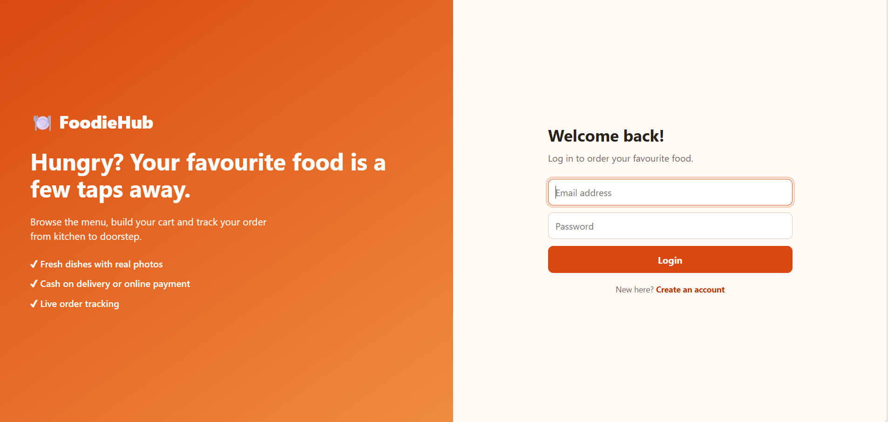
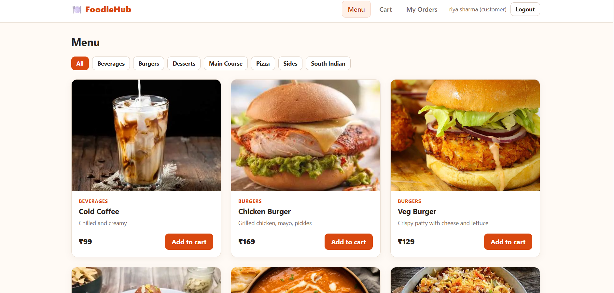

# FoodieHub — Flask + MongoDB Atlas

FoodieHub is a Flask food-ordering app with a single-page HTML frontend, JWT login, customer cart, orders, admin inventory and dish-photo uploads.

## What changed
- Uses MongoDB Atlas through `MONGO_URI` (not SQLAlchemy/PostgreSQL).
- `index.html` is served by Flask at `/`.
- Admin can upload a dish image from a laptop/gallery or use a device camera.
- Images are resized/compressed and stored as data URIs in each MongoDB menu document, so they do not disappear on Render redeploys. Keep photos reasonably sized because Atlas has document/storage limits.
- Menu cards, cart lines and admin inventory display the saved image.

## Local setup
1. Create a free cluster at https://www.mongodb.com/atlas.
2. Create a database user and add your current IP to Atlas Network Access for local development.
3. Copy `.env.example` to `.env` and set `MONGO_URI`, `SECRET_KEY`, `JWT_SECRET_KEY`, `ADMIN_EMAIL`, and `ADMIN_PASSWORD`.
4. In the `food_ordering` folder:
   ```bash
   python -m venv venv
   # Windows:
   venv\Scripts\activate
   pip install -r requirements.txt
   python seed.py
   python run.py
   ```
5. Open http://127.0.0.1:5000.

The seed script creates the admin and sample menu only if they do not already exist. Set a strong `ADMIN_PASSWORD` before running it.

## Render deployment
1. Push the whole `food_ordering` folder to a GitHub repository.
2. In Render, create a **Web Service** from the repository.
3. Build command: `pip install -r requirements.txt`
4. Start command: `gunicorn run:app --bind 0.0.0.0:$PORT --workers 2`
5. Add environment variables in Render:
   - `MONGO_URI`: MongoDB Atlas connection string
   - `MONGO_DB_NAME`: `foodiehub`
   - `SECRET_KEY`: a long random secret
   - `JWT_SECRET_KEY`: a different long random secret
   - `ADMIN_EMAIL`: your admin email
   - `ADMIN_PASSWORD`: a strong admin password
6. In Atlas Network Access, configure access for the deployed app. For a beginner demo, `0.0.0.0/0` permits connections from any IP, so use a strong database password and least-privilege database user; restrict the list further if your hosting setup supports stable outbound IPs.
7. Deploy the service, then open the Render service's Shell and run `python seed.py` once. Do not run the seed command on every app startup.
8. Visit your Render URL and log in using the admin credentials configured before seeding.

## API notes
- Public menu: `GET /api/menu`
- Create dish (admin): `POST /api/menu` with JSON fields `name`, `description`, `category`, `price`, `stock`
- Upload image (admin): `POST /api/menu/<id>/image`, multipart form field named `image`
- Cart and orders: `/api/cart`, `/api/orders`
- Admin inventory and order status: `/api/admin/inventory`, `/api/admin/orders`

## Important limitations
- The ONLINE payment path is a demo simulation, not a real payment gateway.
- Atlas free tier limits and policies can change. Check current limits before deployment.
- This demo stores compressed images inside MongoDB documents. It is suitable for small projects; for many/large photos, use object storage and save only the image URL in MongoDB.
- Never commit `.env`, database credentials, or production secrets to GitHub.

## Screenshots

### Homepage


### Food Menu
